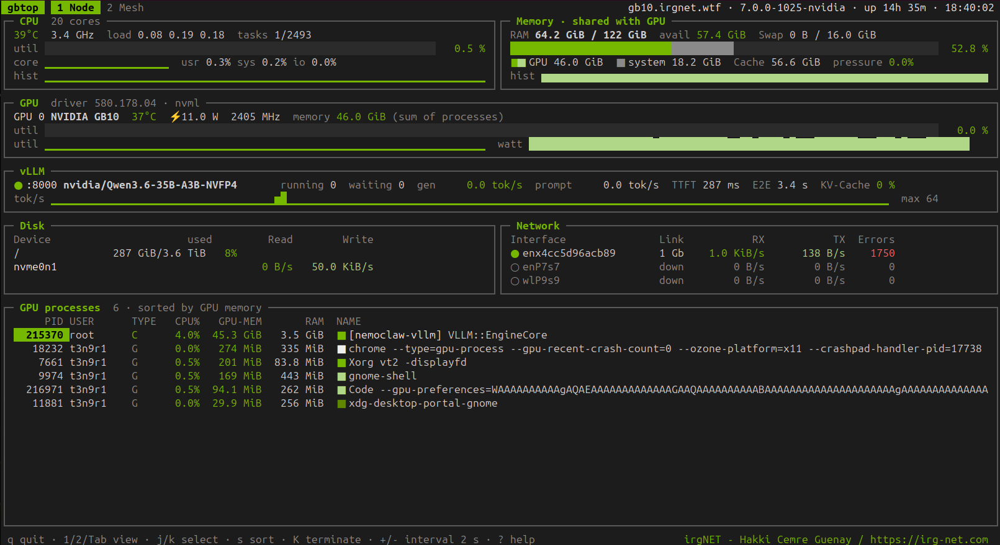

# gbtop

Terminal monitor for NVIDIA GB10 machines (DGX Spark, Dell Pro Max GB10) with vLLM metrics and an agentless mesh view. A single file, Python standard library only.



## Install

```bash
curl -fsSL https://raw.githubusercontent.com/t3n9r1/gbtop/main/install.sh | bash
```

The script installs `gbtop` to `/usr/local/bin` (using `sudo`) or to `~/.local/bin` if `sudo` is not available. It needs `python3` 3.8 or newer, which Ubuntu on the GB10 already ships. Run the same command again to update.

## Uninstall

```bash
sudo rm -f /usr/local/bin/gbtop ~/.local/bin/gbtop
rm -rf ~/.cache/gbtop ~/.config/gbtop      # optional: saved history and node list
```

## Use

```bash
gbtop                                # this machine
gbtop --nodes gb10-b,user@gb10-c     # this machine plus mesh nodes
gbtop --once                         # one snapshot as JSON, for debugging
```

Press `?` inside gbtop for the keys.

## What it shows

The interface uses NVIDIA green (#76B900) on dark gray; amber and red are reserved for warnings.

- **Node view:** per-core CPU, unified memory with each GPU process in its own color, GPU temperature, power, clock and utilization, disk, network, and the GPU processes with their Docker container names.
- **vLLM panel:** generated and prompt tokens per second, running and waiting requests, time to first token, end-to-end latency and KV cache usage. gbtop probes port 8000 and every port it finds on the command line of a running vLLM process; use `--vllm http://host:port` for anything else.
- **Mesh view:** one row per node with latency, CPU, RAM, GPU, temperature, power and tokens per second, plus totals and the alerts of all nodes.
- **Alerts:** low memory, swap use, memory pressure, heat, full disks, queued vLLM requests and a low GPU clock under load.

## Mesh without an agent

Only the machine you sit at needs gbtop. The other nodes need `python3` and SSH access with a key (`ssh node` must work without a password prompt). gbtop sends itself over the SSH connection, runs in memory on the node and reads the data back over the same connection. Nothing is installed there, and the remote process ends when you quit.

There is no fixed limit on the number of nodes; each one takes a row in the mesh view. Nodes can be anything `ssh` accepts: a host name, `user@host`, or an alias from `~/.ssh/config`. Permanent nodes go into `~/.config/gbtop/nodes`, one per line.

## Options

| Option | Meaning |
| --- | --- |
| `-i SECONDS` | sampling interval (default 2) |
| `--vllm URLS` | vLLM base URLs, comma separated |
| `--nodes LIST` | mesh nodes, comma separated |
| `--no-nvml` | read the GPU through `nvidia-smi` instead of the NVML library |
| `--serve` | headless HTTP endpoint with `/api/snapshot` and Prometheus `/metrics` |

---

irgNET - Hakki Cemre Guenay / https://irg-net.com
